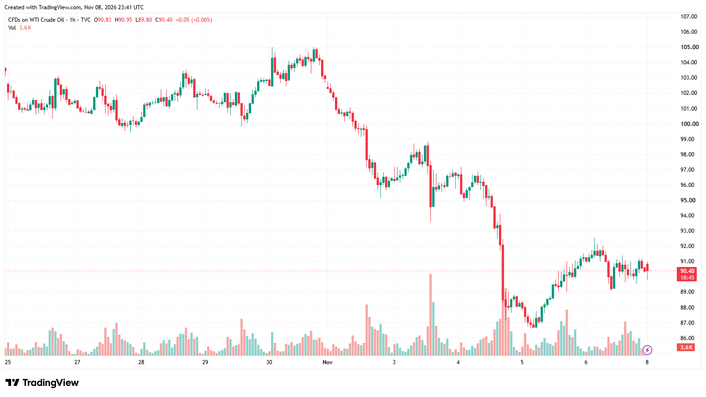

**Tanker strikes, US strikes on Iran and a softer word from Trump: what markets carry into Monday and a CPI week**

*Weekend wrap, Sunday evening, 8 November. All times New York (ET).*

Markets closed on Friday at 4 p.m. after a strong jobs report lifted the odds of a December Fed rate rise to about 78-80% and firmed the dollar. Oil had just finished a week down about 12% on hopes for a deal to end the Iran war. The weekend tested those hopes.

*Weekend wrap: Hormuz risk and the CPI week: 1h chart (TVC:USOIL). Chart: TradingView.*

**What happened.** Tankers were hit again around the Strait of Hormuz. The UK's maritime security agency reported a projectile strike on Saturday afternoon and a separate tanker fire, and the UAE rescued 22 crew from a burning cargo ship. President Trump confirmed what he called minor US strikes on Iran's Qeshm Island. Iran's Revolutionary Guards said they had dropped their self-imposed limit on missile range. Early Sunday, Houthi missiles aimed at Riyadh were intercepted, and debris damaged an Aramco office building; Saudi officials reported no casualties and no hit to production. Gulf stocks, open on Sunday, slipped about 1%.

The counterweight came later on Sunday. Trump told CNN that renewed attacks on Iran were "highly unlikely" if talks make progress. Iran's foreign minister said it was time for Washington to decide on Tehran's offer to reopen Hormuz within two days. Qatar says its mediation continues.

Three other stories mattered. Democrats sketched AI bills for the next Congress, and a New York Times investigation raised questions about Chinese buyers of Nvidia chips, extending last week's AI-stock stress. Stephen Miller takes over as White House chief of staff on Monday. China reported adding about 26 tonnes of gold to its reserves in October.

**On Sunday, Nvidia.** Nvidia's board opened an independent investigation into chief executive Jensen Huang after reports in The New York Times and the Financial Times that a woman he had a relationship with was a suspected Chinese intelligence asset. Huang, who stays in his job, admitted the affair in a note to staff. The board said it has no reason to believe company secrets or national security were compromised. Nvidia is among the largest stocks in the S&P 500 and the Nasdaq-100, so the story adds to the AI-stock stress going into the open.

**What markets are weighing at the reopen** (currencies about 5 p.m., US stock futures and oil 6 p.m.):

- **Oil:** our base case is a firmer open, 0.5% to 2.5% above Friday, with Brent near $100. A US response to Iran's offer could reverse that quickly.
- **US stocks:** futures look set to start slightly lower, about 0.2% to 0.8% for the S&P 500, with technology under the most pressure.
- **Gold:** we expect a quiet open. In this war, higher oil has tended to mean higher inflation, more Fed hikes and a weaker gold price, so the headlines do not translate into a simple safe-haven rally. China's buying is a support.
- **Dollar and yen:** the dollar looks set to open slightly firmer; the euro sits near its lowest level in a year. The yen is close to the zone where Tokyo has warned it could step in.
- **Bitcoin:** it traded all weekend and stood near $75,700 at 1 p.m. Sunday, almost exactly where it was on Friday. It has tracked the Nasdaq closely.

## Scenarios

*Probabilities are Capital Chronicle model estimates for the week to Friday 13 November. They are not market prices.*

**Base case, 55%: talks continue; oil firms at the open, then fades.** Oil opens 0.5% to 2.5% higher and gives most of it back as talks continue. Stocks lean lower at first on AI-stock stress; gold, the euro and the yen stay near Friday's levels; Bitcoin follows the Nasdaq. Tuesday's CPI report then drives rates and the dollar. *Confirms:* oil gives back half its opening gain by Tuesday, Brent stays below $103, and the talks stay active. *Invalidates:* either alternative below.

**Alternative, 25%: escalation around Hormuz.** New strikes on shipping or Gulf energy sites, or wider US or Israeli strikes on Iran. Oil 4% to 10% higher, stocks 1% to 3% lower, the euro weaker, Bitcoin 3% to 6% lower. Gold is torn between inflation fears and falling yields. Dollar-yen is two-sided: oil weakens the yen, while risk-off supports it. *Confirms:* Brent above $103, or a confirmed hit on Gulf oil production or exports. *Invalidates:* two days without a new confirmed attack, with Brent back under $100.

**Alternative, 20%: a deal on Iran's offer.** Washington accepts a framework for Tehran's plan to reopen Hormuz. Oil 3% to 8% lower; stocks, gold and the euro higher; the dollar softer against the yen; Bitcoin up. *Confirms:* a US statement accepting the framework, then tankers moving through the strait. *Invalidates:* a US rejection, the offer lapsing, or oil back above Friday's close after an announcement.

**The week ahead.** China's inflation figures arrive at 8:30 p.m. Sunday. Several Fed officials speak on Monday, and the New York Fed's survey of consumer inflation expectations comes out at 11 a.m. The main event is the October consumer price index on Tuesday at 8:30 a.m. Forecasters expect core prices to rise 0.2% on the month. A 0.3% or higher reading would likely seal a December hike, lift the dollar and weigh on gold and stocks; 0.1% or lower would do the opposite. The weekend's oil moves cannot change October's number, but they shape how the market hears it. Bond markets close on Wednesday for Veterans Day. Producer prices follow on Friday at 8:30 a.m.

Analysis, not financial advice. Capital Chronicle may hold positions in the markets it covers.
